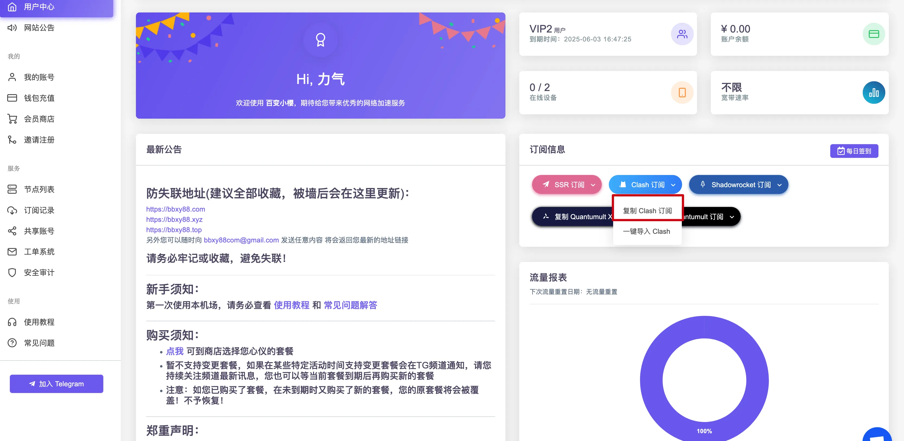
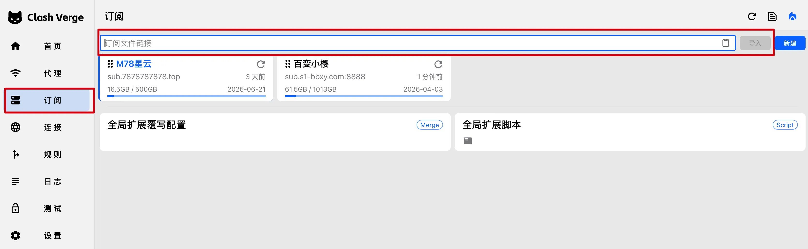
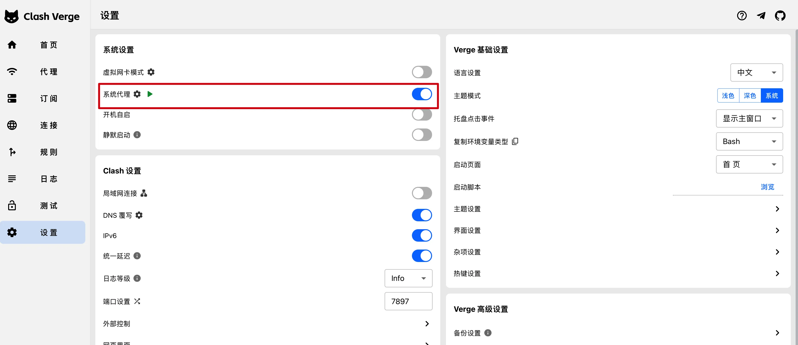
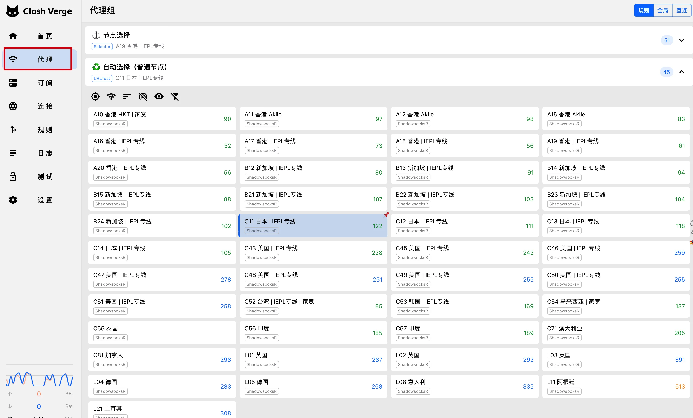
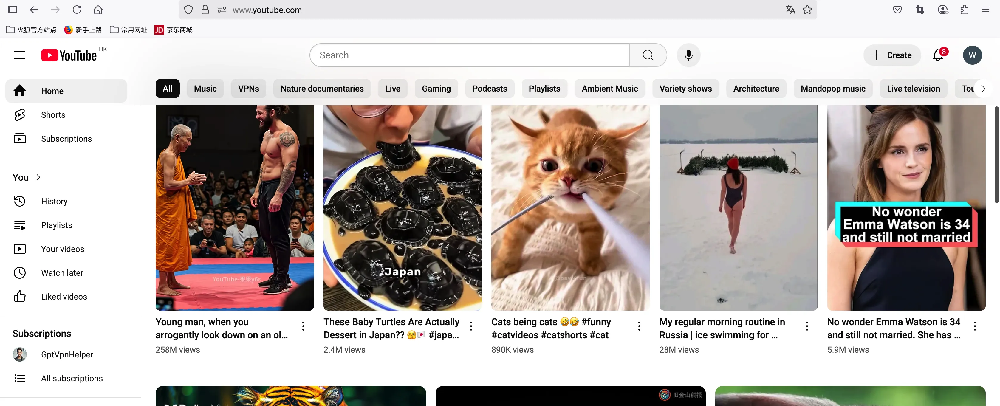

<!-- GitHub Pages mirror of ../clash.md. Keep both files aligned intentionally. -->
# 2026 Clash 机场零基础使用教程：官方客户端 / 通用客户端 / 订阅导入

本教程先区分两种常见用法：**机场官方客户端**和 **Clash / Mihomo / Shadowrocket / Stash 这类通用客户端**。官方客户端通常在机场官网下载，入口、线路和参数由服务商直接维护；通用客户端则需要你从机场后台复制订阅链接，再导入到客户端里。

> 还没决定用哪家服务？先看：[如何挑选优质 Clash 机场（避坑指南）](./choose.html)
>
> 已经导入成功，但“能连上却用不起来”？直接看：[独立排障页](./troubleshooting.html)

最近更新：2026-10-25

> 说明：原版 Clash（`Dreamacro/clash`）已不再适合作为下载入口；本文里的 “Clash” 泛指兼容规则分流生态的客户端/内核，2026 年更常见的是 `mihomo` 系客户端与相关前端。
>
> 下载入口核对时间：2026-10-25。本次核到的 latest：Clash Verge Rev `v2.5.8`、Clash Party `v2.0.4`、ClashX Meta `v1.4.47`、Clash Meta for Android `v2.11.36`、FlClash `v0.9.2`。安装前仍以官方 release 页面和应用商店展示为准。

---

## 这篇教程解决什么问题？

如果你是第一次接触这类工具，通常会卡在下面几件事：

- 不知道该用机场官方客户端，还是 Clash 这类通用客户端；
- 不知道什么时候需要订阅链接，什么时候不用自己复制订阅；
- 不知道 `Rule`、系统代理、`TUN` 分别什么时候开；
- 不知道怎样判断“是真的连通了”，还是只是软件显示在运行。

本文就是把这几个最基础的问题走一遍，先让你**稳定跑起来**，再去研究更细的选线、选协议和分流。

---

## 使用前准备

- 一台可正常联网的设备：Windows / macOS / Android / iOS；
- 一个能登录机场官网后台的试用/付费账号；
- 如果你打算使用通用客户端，再准备一条可用订阅链接；
- 10 到 20 分钟的完整配置时间；
- 一个基本原则：**先跑通，再折腾高级设置**。

---

## 还没有订阅？可先看这些入口

下面只放简单信息和注册链接，方便还没有机场账号的新手先拿到账号。价格、客户端支持和可用入口可能随时间变化，付款前请以官网结算页和服务商公告为准。

> 如果你是第一次购买，先用月付/季付验证本地网络、晚高峰和 AI/流媒体可用性。普通用户先看 `BoostNet / 悠兔`；年付轻量或低流量备用看 `青云梯 / 银河云`；有原生 IP、跨境业务或团队办公需求，再分别看 `TNTCloud / 唯兔云 / WgetCloud`；有明确目标国家或家宽出口需求再看 `TAG`。

| 机场 | 简单定位 | 入门套餐 / 实付参考 | 客户端 | 注册链接 |
| --- | --- | --- | --- | --- |
| **BoostNet** | 综合主力首选，适合 AI、流媒体和远程办公一起用 | 200GB/月，¥49/月 | 官方客户端 + Clash 等通用客户端 | [立即注册](https://tw.boostqz.com/?path=register&code=kKMFirlm) |
| **悠兔机场** | 高端 IEPL 专线，适合长期主用和晚高峰稳定需求 | 先试 150GB/月 ¥39；主力 300GB/月 ¥59 | 官方客户端 + Clash 等通用客户端 | [立即注册](https://tw.youtu1.com/?path=register&code=erkQTmbM) · [备用](https://tw.youtunice.com/?path=register&code=erkQTmbM) |
| **青云梯** | 老牌 IPLC 机场，适合年付轻量和家庭多设备 | 60GB/月，¥96/年（此档仅年付） | 仅官方客户端 | [立即注册](https://realvtest.qytvipaff.cc/register?aff=zcIlh0VY) |
| **TNTCloud** | IPLC 专线，适合已有主力后补原生 IP / 专项出口 | 试线路 110GB/月 ¥20；主用 220GB/月 ¥40 | 仅官方客户端 | [立即注册](https://tanu095.tntvipaff.cc/#/register?code=7MPbfr89) |
| **唯兔云** | IPLC + SS2022，适合 TikTok、电商和多区域业务 | 先试 100GB/月 ¥14.9；主力 200GB/月 ¥29.9 | 仅官方客户端 | [立即注册](https://realvpn.v2yunvipaff.com/#/?code=5LVpl8Mh) |
| **银河云** | 预算备用，适合当第二家低流量线路 | 50GB/月 ¥98/年；月付可看 100GB/月 ¥18 | 仅官方客户端 | [立即注册](https://realvtest.galaxyvipaff01.cc/register?aff=tcOd0ob7) |
| **WgetCloud** | 团队办公和高预算稳定性刚需 | 230GB/30天，实付 ¥297/90天（折合 ¥99/月，不代表可月付） | Clash 等通用客户端 | [立即注册（需外网）](https://invite.wgetcloud.ltd/auth/register?code=kVJQPh) |
| **TAG** | 多地区与家宽出口补充，适合目标国家/平台明确的人 | 历史记录：Special ¥162/年（全年共 200GB）；Bronze ¥185/季（250GB/月） | 历史资料支持官方及通用客户端，付款前核对 | [立即注册](https://1028605.l49.net/#/auth/0XHcA2ji) |

> 本次入口更新时间：2026-10-25。机场顺序、注册链接、套餐参考和客户端口径按 `../clash/README.md` 2026-10-24 版本同步；百变小樱已不再列入推荐，TAG 套餐为 2026-08-24 历史记录。价格为资料记录价，不代表当前结算价；付款前请以服务商公告和结算页为准。
>
> 想按本教程用 Clash / Mihomo 类通用客户端导入订阅，优先看 `BoostNet / 悠兔 / WgetCloud`；青云梯、TNTCloud、唯兔云、银河云目前只支持官方客户端，买前先确认自己的设备有官方客户端。

---

## 1. 先判断：用官方客户端，还是通用客户端？

现在很多机场同时提供两种使用方式：

| 客户端类型 | 从哪里来 | 是否需要订阅链接 | 适合谁 |
| --- | --- | --- | --- |
| **机场官方客户端** | 登录机场官网，在后台或客户端下载页获取 | 通常不需要手动复制，登录账号或按官网教程导入即可 | 新手、想少折腾、希望入口和线路自动适配的人 |
| **通用客户端** | Clash Verge Rev、Clash Party、Clash Meta for Android、Shadowrocket、Stash 等 | 需要从机场后台复制订阅链接，或使用“一键导入” | 想自定义规则、策略组、DNS、TUN，或需要跨服务商统一管理的人 |

如果机场明确推荐官方客户端，优先按官网客户端下载和使用。官方客户端通常会内置当前可用入口、线路参数和更新逻辑，稳定性和线路适配往往更好，也更适合近期入口频繁调整的阶段。

如果你要用通用客户端，再去后台找 “订阅”、“一键导入”、“复制订阅链接” 这类入口。订阅链接一般以 `https://` 开头，可以被 Clash / Mihomo / Shadowrocket / Stash 等客户端导入。

注意两点：

- 订阅链接本质上是账号密钥，不要发给别人，也不要交给来路不明的第三方转换网站；
- 最好把官网登录地址、官方客户端下载入口、订阅链接和备用网址单独保存，避免后面临时找不到入口。

下面这张图只是“复制订阅链接”的示意，不代表你必须使用同一个面板，也不代表所有机场都要求手动复制订阅：

---

## 2. 路线 A：使用机场官方客户端

如果你选择官方客户端，流程通常是：

1. 登录机场官网；
2. 打开“客户端下载”、“使用教程”或“软件下载”页面；
3. 按你的系统下载 Windows / macOS / Android / iOS 客户端；
4. 按官网说明登录账号、复制授权信息，或点击官方的一键导入按钮；
5. 在客户端里选择节点或模式，开启连接。

官方客户端的优点是入口、订阅格式、线路参数一般由机场自己维护。遇到入口调整、通用订阅临时收紧、特殊协议参数变化时，官方客户端通常更容易保持可用。

注意事项：

- 只从机场官网后台下载官方客户端，不要用群里转发的安装包；
- Windows / macOS 安装时注意系统安全提示，确认来源是你购买的服务商；
- 如果官方客户端已经能稳定使用，新手没必要一开始就折腾 Clash、Shadowrocket 或订阅转换。

---

## 3. 路线 B：使用 Clash 等通用客户端

如果你选择通用客户端，才需要先下载客户端，再导入订阅链接。2026 年新手优先选择仍在维护、支持 `mihomo`、支持 `Rule` 和 `TUN` 的客户端。旧教程里常见的 Clash for Windows / 原版 Clash 不建议再作为新手首选；本次核对时 `Dreamacro/clash` 原仓库地址已返回 404。

| 平台 | 推荐客户端 | 下载地址 |
| --- | --- | --- |
| **Windows** | Clash Verge Rev | [GitHub 下载](https://github.com/clash-verge-rev/clash-verge-rev/releases) |
|  | Clash Party | [GitHub 下载](https://github.com/mihomo-party-org/clash-party/releases) |
|  | FlClash | [GitHub 下载](https://github.com/chen08209/FlClash/releases) |
|  | v2rayN（多内核，偏进阶） | [GitHub 下载](https://github.com/2dust/v2rayN/releases) |
| **macOS** | Clash Verge Rev | [GitHub 下载](https://github.com/clash-verge-rev/clash-verge-rev/releases) |
|  | Clash Party | [GitHub 下载](https://github.com/mihomo-party-org/clash-party/releases) |
|  | ClashX Meta | [GitHub 下载](https://github.com/MetaCubeX/ClashX.Meta/releases) |
|  | FlClash | [GitHub 下载](https://github.com/chen08209/FlClash/releases) |
| **Android** | Clash Meta for Android | [GitHub 下载](https://github.com/MetaCubeX/ClashMetaForAndroid/releases) |
|  | FlClash | [GitHub 下载](https://github.com/chen08209/FlClash/releases) |
|  | v2rayNG（多内核，偏进阶） | [GitHub 下载](https://github.com/2dust/v2rayNG/releases) |
| **iOS / iPadOS** | Shadowrocket | [App Store（付费）](https://apps.apple.com/app/shadowrocket/id932747118) |
|  | Stash | [App Store（付费）](https://apps.apple.com/app/stash-rule-based-proxy/id1596063349) |
|  | sing-box（1.14 起重新上架，需 sing-box 格式订阅） | [App Store（免费）](https://apps.apple.com/us/app/sing-box-mt/id6785326793) |

下载时注意：

- 看清系统版本和芯片架构，不要把 macOS 的 Intel 版装到 Apple Silicon，或者把 ARM 版装到旧机器上；
- Clash Verge Rev 新版本已不再面向 Windows 7；老系统不要盲目照搬 2026 教程；
- Windows 首次启用 `TUN` 时，可能需要管理员权限或额外安装驱动；
- iOS 常见客户端多为付费应用，且可能需要外区 Apple ID。

### 把订阅导入到通用客户端

以 Clash Verge Rev 这一类桌面客户端为例，核心动作只有两个：

1. 粘贴订阅链接；
2. 点击导入或更新配置。

如果导入失败，先不要急着换机场，先确认：

- 订阅链接有没有复制完整；
- 客户端时间是否正确；
- 你当前网络是否能打开机场官网；
- 是否把链接粘贴到了错误的入口，例如“本地配置”而不是“订阅配置”；
- 客户端是否过旧，不能识别 Reality / Hysteria2 / TUIC / xHTTP 等新字段；
- 部分机场对订阅请求头有要求，必要时在客户端里调整订阅 User-Agent，或使用面板提供的“Clash/Mihomo 订阅”专用入口。

---

## 4. 日常默认用 `Rule` 模式，并开启系统代理

对大多数新手来说，最稳妥的默认组合是：

- 模式选 `Rule`；
- 打开系统代理；
- 先不要一上来就用 `Global`。

`Rule` 的作用是让国内流量尽量直连、国外流量按规则走代理。这样通常比全局模式更适合日常使用，也更不容易把本地服务、银行网站、局域网设备一起代理出去。

经验上可以记成一句话：

- 浏览器和大多数软件，先靠系统代理；
- 只有“明明开着代理，但某些 App 还是不走”的时候，再去考虑 `TUN`。

---

## 5. 某些 App / 游戏不走代理时，再启用 `TUN`

`TUN` 的作用，是在更底层接管系统流量。它适合这些情况：

- 浏览器可以访问，但 Telegram / Discord / ChatGPT 客户端不行；
- 某些软件没有代理设置入口；
- 游戏或桌面应用不跟随系统代理。

但 `TUN` 不是“越早开越好”，因为它通常意味着：

- 需要额外权限；
- 会引入 DNS、驱动、系统兼容性问题；
- 排障时变量更多。

所以顺序建议始终是：

1. 先 `Rule` + 系统代理；
2. 确认浏览器连通；
3. 只有 App 还不通时，再启用 `TUN`。

---

## 6. 选择节点时，先看“稳定可用”，再看“最低延迟”

很多新手第一反应是只看延迟，但延迟低不一定代表真实体验最好。实际选择节点时，优先级建议是：

1. 地区是否符合你的需求，例如美区、日区、新加坡；
2. 线路是否稳定，例如中转、IEPL、IPLC；
3. 是否存在 AI / 流媒体可用性说明；
4. 在此基础上再看延迟和测速结果。

如果你只是日常网页、GitHub、轻度 AI 使用，先选一个**稳定节点**即可；不要刚导入就开始频繁切二三十个节点。

---

## 7. 用“最小闭环”验证是否真的配置成功

不要一上来就用一堆复杂服务测试。建议按这个顺序验证：

1. 打开 `https://www.youtube.com` 或 `https://github.com`，确认基础连通；
2. 再打开你真正要用的服务，例如 ChatGPT、Claude、Netflix；
3. 如果基础站点能开，而目标服务不能开，优先怀疑**地区/IP 可用性**，不是立刻怀疑客户端坏了。

这里有个很重要的认知：

- `YouTube` 能打开，只能说明基础代理通了；
- `ChatGPT` / `Claude` / 某些流媒体打不开，很多时候是节点地区、共享 IP 信誉、账号风控的问题。

---

## 8. 把“能用”变成“长期可用”

第一次跑通之后，建议立刻做这几件事：

- 开启“启动时自动更新订阅”或手动养成更新习惯；
- 保存至少 2 个不同地区的可用节点；
- 保存订阅链接、官网登录地址和备用网址；
- 记录自己当前可用的客户端版本，别随便回退到旧教程里的老客户端。

长期使用时，真正影响体验的通常不是“会不会导入”，而是：

- 晚高峰是否掉速；
- 规则集和 Geo 数据是否过期；
- 服务商公告和客服是否可联系；
- 你是否把所有希望都压在一个节点或一个服务上；
- 内核和客户端是否长期不更新，导致新协议字段、安全修复或订阅格式兼容性跟不上。

---

## 9. 新手最常踩的坑

### 下载了过时客户端

很多搜索结果还是旧教程，容易把人带到停更或维护不积极的客户端。2026 年新手优先看是否仍在维护、是否支持 `mihomo`、是否支持 `TUN`，以及 release 页面近期是否仍有更新。

### 一上来就开 `Global`

`Global` 可以临时排障，但不建议拿来做长期默认模式。长期日常使用优先 `Rule`。

### 浏览器能开，App 不能开

这通常不是“机场坏了”，而是系统代理没有覆盖到该应用。优先检查 `TUN`、防火墙、应用自身缓存的 DNS。

### 软件显示连上了，但网页打不开

这通常优先排查：

- DNS；
- 系统时间；
- 规则集是否过期；
- 你是否误开了 `Direct`。

### 订阅能导入，但部分新协议节点全红

这通常不是“所有节点都坏了”，而是客户端/内核和订阅字段不匹配。优先更新到最新 `mihomo` 系客户端；如果机场面板提供多个订阅格式，优先选择 `Clash.Meta / Mihomo` 格式。

### 到处分享订阅链接

订阅链接不是邀请码，它和你的账号资源绑定。泄露后最常见的后果不是“被黑”，而是流量被别人直接用掉。

---

## FAQ（常见问题）

### Q1：客户端导入订阅失败怎么办？

- 先确认链接复制完整；
- 用浏览器打开机场官网，看面板是否正常；
- 尝试在客户端里重新新建订阅，而不是重复覆盖旧配置；
- 仍不行时，再看是否是客户端版本过旧，或者订阅 User-Agent / 订阅格式不匹配。

### Q2：为什么我开着代理，但还是打不开网页？

- 检查是否处于 `Rule` 或 `Global`，不要误开 `Direct`；
- 检查系统时间和时区；
- 检查 DNS 设置；
- 更详细流程见：[独立排障页](./troubleshooting.html)。

### Q3：为什么延迟很低，但速度还是慢？

低延迟只说明“握手不慢”，不代表线路一定不拥堵。晚高峰、超售、地区出口质量，都会让测速和真实下载速度产生差异。

### Q4：为什么 YouTube 能开，ChatGPT 却不行？

这通常不是客户端配置问题，而是节点地区、共享 IP 信誉或账号风控问题。优先更换同地区不同节点，或者换支持地区。

### Q5：iPhone 上和电脑上为什么体验不一样？

iPhone 多数客户端是通过 VPN 模式接管流量，而桌面端常先走系统代理，所以表现不同很常见。桌面端优先检查系统代理、`TUN` 和防火墙。

---

> 本教程仅用于网络工具基础配置与科普说明，请遵守当地法律法规，不要用于非法用途。

## 推荐阅读

- [如何挑选优质 Clash 机场（避坑与选购指南）](./choose.html)
- [Clash / Mihomo 独立排障指南（按症状排查）](./troubleshooting.html)
- [Clash 机场常用名称解释](./mingci.html)
